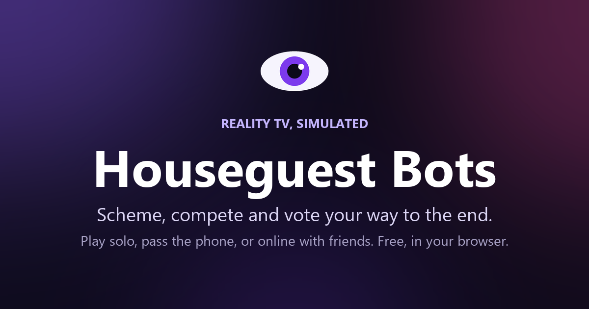

# Houseguest Bots

A reality TV strategy game that runs in your browser. Move into a house full of cartoon houseguests, make
alliances, win competitions, survive the vote, and convince the jury you played the best game.

**Play it: <https://spotlegame.co.uk/houseguests/>**



## Ways to play

- **Play as a houseguest.** Solo against bots, or pass-and-play with friends on one device.
- **Play online.** Everyone on their own phone or computer. Host a game, share the code or the invite link, and
  each friend who joins takes a bot's place. Games can be public (listed on the start screen) or private.
- **Watch the bots.** Every houseguest is a bot; you see everything they do behind the scenes.
- **Classic simulator.** The original quick simulator: step through a season week by week, with the twists from
  the season editor (double and triple evictions, teams, split house and more).

## What's in a season

- **A week in the house**: Head of Household comp, nominations, the Veto, campaigning, speeches and a live vote.
  Bigger houses get a third nominee and a Block Breaker comp.
- **A social game**: chat, pitch a target, make final-two deals, start alliances, spread rumours, flirt, snoop on
  meetings, or call a house meeting. Bots remember promises you kept and broke, and so does the jury.
- **Bots with personalities**: masterminds, comp beasts, floaters, loyal soldiers, villains and more. They keep
  their personality secret; you work it out from how they behave.
- **About 40 competitions** played on your phone or computer: memory, reflex, puzzle, quiz, endurance and luck.
  Bots play the same comp you do.
- **Twists**: secret powers, a secret Head of Household, Have-Nots, the audience picking a nominee, and a Battle
  Back for evicted houseguests.
- **A finale**: a three-part final Head of Household, speeches, jury questions, and a vote that depends on how
  you treated people on the way.
- **A career**: stats, achievements, best comp scores, and a Hall of Winners and Hall of Losers whose houseguests
  can be cast again.

Difficulty runs from Casual to Cutthroat, and the house rules (number of social actions, kinds of comps, big
weeks) can be changed before a season starts. The game is in English and French.

## Your cast

Every season starts with a cast of made-up cartoon houseguests, drawn on the spot, so no two look alike. Deal a
new cast, design your own avatar feature by feature, or upload your own pictures. A cast can be shared with a
link or a code.

## Running it locally

```sh
npm install
npm start          # http://localhost:3000
```

Tests (the full suite takes about three minutes, so run the part you changed):

```sh
CI=true npx react-scripts test --watchAll=false src/career
npx tsc --noEmit
```

Online play goes through a small WebSocket relay. To run your own, see [server/README.md](server/README.md).

## Where things are

| Folder | What's in it |
| --- | --- |
| `src/playerMode` | Playing a season: the controller (one class across `controllerCore`, `controllerComps`, `controllerSocial`, `controllerHouse` and `playerModeController`), the week's steps, saving |
| `src/playerMode/comps` | Every competition, and how bots play them |
| `src/playerMode/social` | Alliances, promises, personalities, the jury, powers and twists |
| `src/playerMode/net` | Online play |
| `src/playerMode/ui` | The screens of player mode |
| `src/components`, `src/model`, `src/utils` | The classic simulator and what both modes share |
| `src/cartoon` | Drawing the cartoon houseguests |
| `src/career` | Stats, achievements and the halls |
| `server` | The online relay |

## Contact

Questions, bugs and ideas: <spotlegame@gmail.com>.

## Credits

Houseguest Bots began as [bb-bots](https://github.com/spaulmark/bb-bots) by Spencer Paulmark, a simulator for a
social strategy game, and still includes it as the classic mode. Released under the MIT licence; see
[LICENSE](LICENSE).
